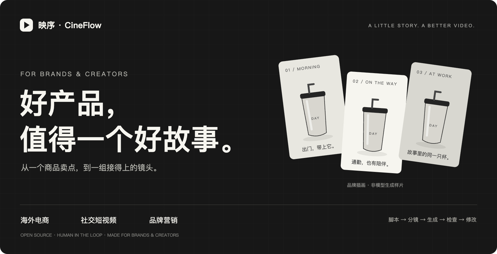
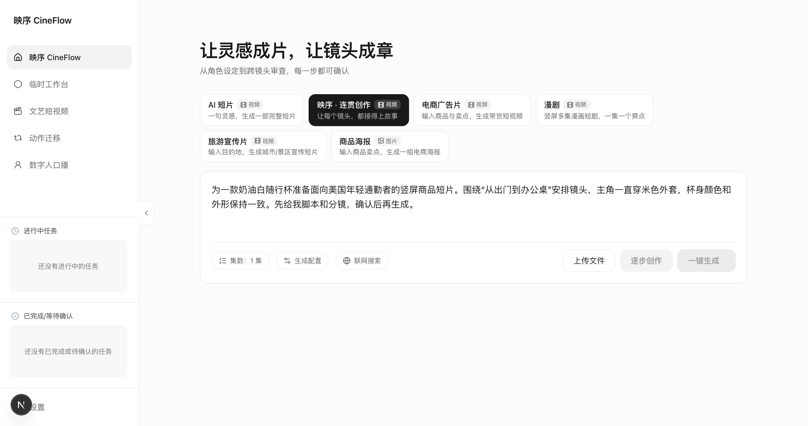
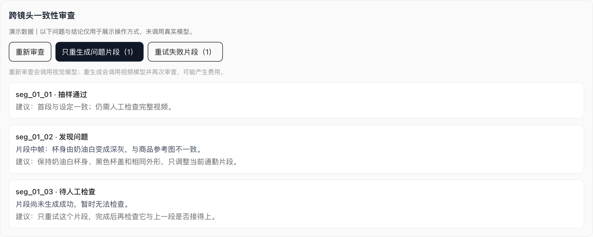

<p align="center">
  
</p>

<p align="center"><b>给出海商品和品牌，拍一个好故事。</b></p>
<p align="center">🛍️ 海外电商 · 📱 社交短视频 · 🎯 品牌营销</p>
<p align="center"><b>中文</b> · <a href="README_EN.md">English</a> · <a href="#-先跑起来">开始使用</a> · <a href="docs/continuity-agent.md">详细指南</a></p>

给同一只杯子拍三段视频，第三段却变了颜色。主角上一秒穿白衬衫，下一秒换了件外套。单独看都挺好，剪到一起就露馅了。

从商品卖点或一个视频想法出发，先写脚本、定角色和场景，再生成镜头。生成之后，它会抽帧检查前后有没有明显对不上的地方，把问题指到具体片段，方便你只重做那一段。

你来拿主意，它负责把流程串起来。每一步都能看、能改，也能停下来重新选。

## 🌍 为哪些人准备

如果你在做海外电商、运营短视频账号，或者帮品牌做内容，这几个用法可能比较贴近你的日常：

| 你正在忙什么 | 可以从这条内容开始 | 创作时值得盯住的细节 |
| --- | --- | --- |
| 🛍️ Shopify 独立站、Amazon 商品内容 | 给一只随行杯做“通勤的一天”：出门、地铁、办公桌 | 同一款商品的颜色、外形，别拍着拍着变成另一款 |
| 📱 TikTok、Instagram Reels、YouTube Shorts | 用一个生活场景讲清一个卖点，先做一条竖屏短片 | 主角、服装、场景是否接得上，开头够不够直接 |
| 🎯 Meta 等渠道的广告创意准备 | 围绕同一个产品，分别尝试通勤、健身、旅行三个切入点 | 每版表达一个重点，逐版创建、检查和修改 |
| ✨ 品牌上新与内容营销 | 把新品放进一个小故事，做上新预热视频或品牌氛围短片 | 视觉风格统一，商品始终是故事里的主角 |

这里说的是**内容创作用途**。目前没有连接店铺、自动发布或广告投放，也不读取平台数据做自动 A/B 测试。界面是中文；面向海外市场的文案、配音、字幕和本地表达仍需要你检查，多语言本地化还没做成完整流程。

## 👀 先看看里面长什么样

### 从一个具体的想法开始

商品、受众、使用场景、画面比例，都可以在开拍前想清楚。下面是在实际工作台里填写的一条出海商品视频需求，还没有提交生成。



### 哪一段出了问题，就处理哪一段

审查面板会列出片段、问题和修复建议。你可以只重生成有问题的片段，也可以换回旧版本，再检查一遍。



*上图是实际界面加载演示数据的截图，用来说明操作方式；图中的问题和结论不是一次真实模型审查的结果。*

## 🧩 几件比较实用的小事

| 功能 | 用起来是什么感觉 |
| --- | --- |
| ✍️ 先把脚本说清楚 | 先看故事和分镜，觉得方向不对就改，不急着生成视频 |
| 🧍 留住同一个主角 | 选好角色和场景设定图，让后续创作与审查有个参照 |
| 🔎 帮忙找穿帮 | 抽取首、中、尾帧，对照设定图和同集上一片段，检查可见差异 |
| 🛠️ 带着建议重拍 | 选中问题片段，把修复建议带进提示词，再生成、再审查 |
| ⚡ 几段一起做 | 独立片段并行生成，连贯创作场景会限制同一进程内的服务商并发量 |
| ↩️ 失败了再试一次 | 默认额外重试一次，也能手动重试失败片段；已有版本保留着 |

**审查与修复功能在「映序 · 连贯创作」场景里。** 也可以选择电商广告、短片、漫剧、旅游宣传和商品海报模板；这些模板还没有全部接入一致性审查。

## ☕ 拿一只随行杯试试

先从小一点的任务开始。下面这段可以直接放进工作台，再按你的商品改：

> 为一款奶油白随行杯准备一条面向美国年轻通勤者的竖屏商品短片。先做一集，围绕“从出门到办公桌”的小故事安排镜头。主角一直穿米色外套，杯身颜色和外形保持一致。画面自然、生活化，避免夸大产品性能。先给我脚本和分镜，我确认后再生成。

流程大致是这样：

**写下需求 → 看脚本 → 定角色和场景 → 确认分镜与参考图 → 生成片段 → 检查并修复 → 人工确认后合成。**

如果你要测三种卖点，先分别建三个项目。现在还没有“一次自动跑完几十个广告版本”的批量实验功能。

## 🚀 先跑起来

准备 Python 3.10+（推荐 3.12）、[uv](https://docs.astral.sh/uv/)、Node.js 20.9+、npm、ffmpeg 和 ffprobe，再配好所选模型的 API Key。

```bash
git clone https://github.com/yunerjun4869-cmd/cineflow-agent.git
cd cineflow-agent
./scripts/install.sh
./scripts/dev.sh
```

打开 [localhost:3000](http://localhost:3000)，在设置页填写模型密钥，回首页选择 **「映序 · 连贯创作」**。建议从一集、少量片段开始。

Windows 可使用 `scripts\install.bat` 安装，随后分别启动后端和前端：

```bash
# 终端一
cd backend
uv sync --extra dev --python 3.12
uv run python api_server.py
```

```bash
# 终端二
cd frontend
npm ci
npm run dev
```

模型调用会产生服务商费用；自动重试也可能再次计费。密钥放在设置页、`backend/config.yaml` 或环境变量里，不要提交进仓库。配置细节见 [使用指南](docs/continuity-agent.md) 和 [配置说明](docs/configuration.md)。

## 🪴 现在做到哪儿了

这还是一个在打磨的原型。生成流程、抽帧审查、定向修复入口和有限重试已经接上；真实模型下能找出多少问题、修复后有多大改善，还需要认真测。

- **已验证：** 44 项后端测试、前端类型检查和构建、本地合成视频抽帧。测试里的模型响应是模拟的。
- **仍要人工看：** 目前检查首／中／尾帧，可能漏掉中间的动作或误判合理转场；不能保证商品细节、文字和品牌标识完全准确。
- **使用范围：** 并发限制只覆盖同一后端进程的连贯创作场景。依赖漏洞和公开服务的鉴权加固仍待处理，先用于本地实验。

接下来想先把三件事做好：用真实商品短片建立评测集；把问题帧并排展示，方便人判断；补上面向海外内容的语言与字幕流程。它们目前都还在计划中。

## 🛠️ 想继续改它

前端是 Next.js / React，后端是 FastAPI。连贯创作功能集中在 `backend/scenarios/continuity_film/`，审查界面在 `frontend/components/stages/ContinuityReview.tsx`。

[产品思路](docs/product.md) · [实现与限制](docs/continuity-agent.md) · [场景扩展](docs/scenarios.md) · [架构](docs/architecture.md) · [截图说明](docs/images/README.md)

```bash
cd backend && uv run --extra dev pytest
cd ../frontend && npx tsc --noEmit && npm run build
```

## 🐰 关于作者

由 [兔主任 Bonnie](https://github.com/yunerjun4869-cmd) 创作和维护。想做的事情很具体：让一个商品想法，能一步步变成前后接得上的小故事。

欢迎带着你的使用场景来提 Issue：你在卖什么、想拍什么、卡在哪一步，都可以聊。项目采用 [MIT License](LICENSE)，版权声明见许可文件。
