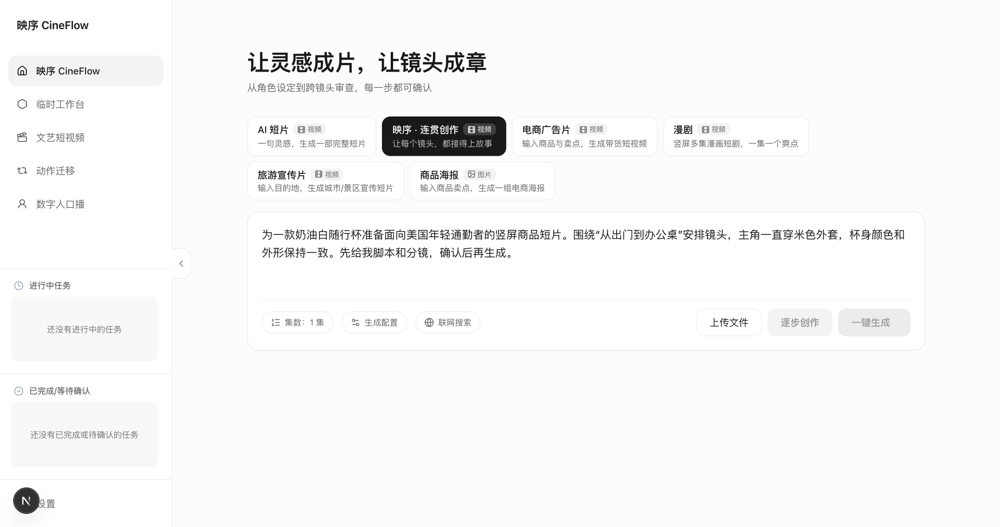
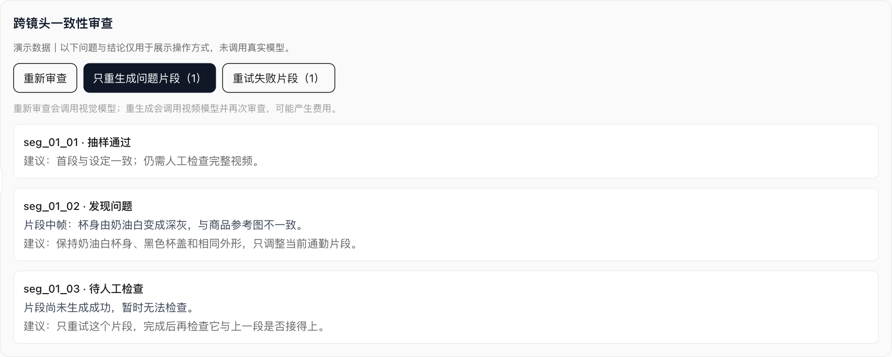

<p align="center"></p>
<h1 align="center">CineFlow · 映序</h1>
<p align="center"><b>Give your product a story worth watching.</b></p>
<p align="center">🛍️ Cross-border e-commerce · 📱 Social video · 🎯 Brand marketing</p>
<p align="center"><a href="README.md">中文</a> · <b>English</b></p>

Three clips. One travel cup. Somehow, by the third clip, the cup has changed color.

Little inconsistencies like that can turn a quick AI video experiment into an afternoon of rework. **CineFlow** puts a review step between generating your clips and assembling the final video. It samples frames, checks them against your chosen references and neighboring clips, and points you toward the part that may need another take.

Start with a product benefit or a story idea. Work through the script, characters, scenes, and shots. Keep the parts you like; revisit the parts you don't.

## 🌍 Who it's for

| What you're working on | A place to start | What to watch for |
| --- | --- | --- |
| 🛍️ Shopify or Amazon product content | A travel cup's journey from the front door to an office desk | The product should keep the same color and shape |
| 📱 TikTok, Reels, or YouTube Shorts | One everyday moment built around one product benefit | Consistent characters, outfits, and locations |
| 🎯 Ad creative for channels such as Meta | Separate concepts for commuting, workouts, and travel | One clear idea per project, reviewed before assembly |
| ✨ A launch or brand story | A short story that gives a new product some context | A visual style that carries across the shots |

These are intended content-creation uses. There are no store connections, publishing integrations, ad-buying tools, or automated A/B experiments. The interface is currently in Chinese. Copy, voice, subtitles, and local-market nuance still need your attention; a complete multilingual localization workflow is planned, not built.

## 👀 A look inside

### Start with a brief

Describe the product, audience, setting, and details you want to keep consistent. This screenshot shows the real workspace with an example brief entered; no generation request was submitted.



### Fix the clip that needs another take

The review panel lists findings and suggested changes. From there, you can regenerate flagged clips or retry failed ones.



*The review screenshot uses demo data in the actual application component. Its findings are illustrative, not results from a real model evaluation. The cover is a brand illustration, not generated footage.*

## 🧩 A few useful things

| Feature | What it helps you do |
| --- | --- |
| ✍️ Script and storyboard review | Change direction before spending on video generation |
| 🧍 Character and scene references | Give later stages a consistent visual starting point |
| 🔎 Sampled continuity checks | Compare first/middle/last frames, selected assets, and neighboring clips in the same episode |
| 🛠️ Targeted repair | Send a review suggestion into the prompt for a selected clip, then review again |
| ⚡ Parallel generation | Generate independent clips together, with per-provider limits in one backend process |
| ↩️ Bounded retries | Try a failed clip once more by default, while keeping previous versions |

Select **映序 · 连贯创作** for the review-and-repair workflow. Ad, short-film, comic, travel, and poster templates are also available; continuity review has not been wired into every template.

## ☕ Try a small project first

A simple brief could be: “A cream-colored travel cup, a young commuter, and a morning journey from home to the office. Keep the cup's shape, color, and the character's outfit consistent. Show the script and storyboard before generating video.”

**Brief → script → characters and scenes → storyboard and references → clips → review and repair → manual approval → assembly.**

For different creative angles, start with separate projects. Automatic large-scale ad variant testing isn't part of the current prototype.

## 🚀 Run it locally

You'll need Python 3.10+ (3.12 recommended), uv, Node.js 20.9+, npm, ffmpeg, ffprobe, and API keys for your selected models.

```bash
git clone https://github.com/yunerjun4869-cmd/cineflow-agent.git
cd cineflow-agent
./scripts/install.sh
./scripts/dev.sh
```

Open [localhost:3000](http://localhost:3000), add your provider keys in Settings, and choose **映序 · 连贯创作**. Start with one episode and a few clips. Model calls and retries may incur charges. Keep credentials out of Git.

See the [setup and configuration guide](docs/configuration.md) and [workflow guide](docs/continuity-agent.md).

## 🪴 Where things stand

This is a working prototype, with real-model evaluation still ahead. The local checks include 44 passing backend tests, TypeScript checking, a production build, and frame extraction from a locally synthesized video. The model responses in tests are mocked.

Frame sampling can miss issues or flag an intentional change. Product details, text, and logos still need manual inspection. Provider limits apply to this scenario in one backend process. Dependency issues and public-service authentication hardening remain to be addressed.

Next: a real product-video evaluation set, side-by-side visual evidence, and a language/subtitle workflow for overseas content. These are plans, not current features.

## 🐰 About the creator

Created and maintained by [Bonnie](https://github.com/yunerjun4869-cmd). The idea is simple: help a product brief become a small story whose shots actually fit together.

Have a use case in mind? Open an issue and tell me what you're selling, what you'd like to make, and where you got stuck. Released under the [MIT License](LICENSE); copyright notices are in the license file.

[Product notes](docs/product.md) · [Implementation](docs/continuity-agent.md) · [Architecture](docs/architecture.md) · [Screenshot notes](docs/images/README.md)
